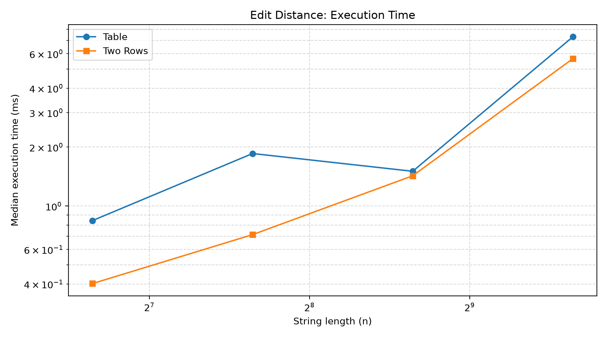
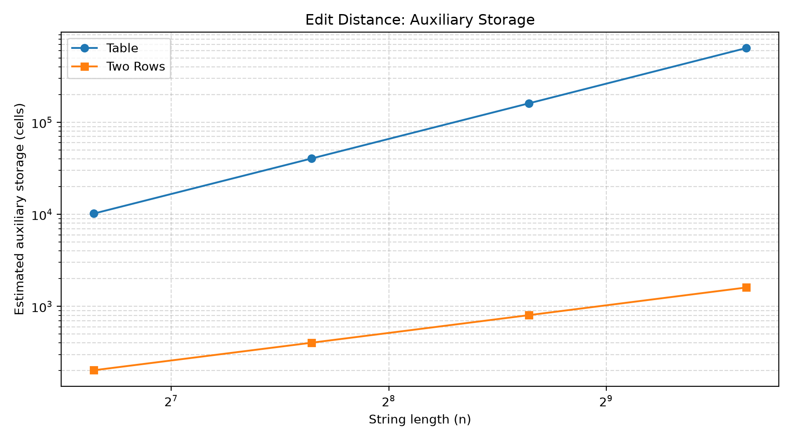
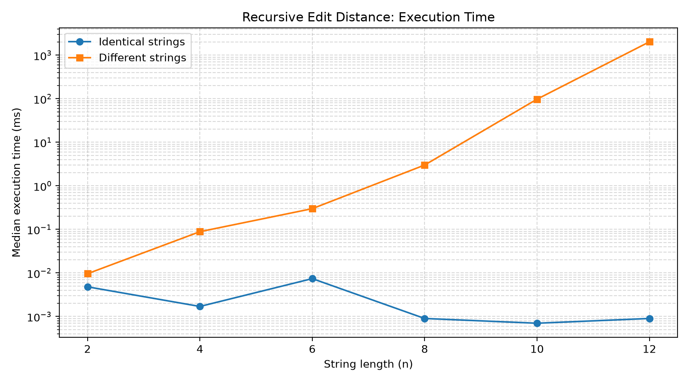
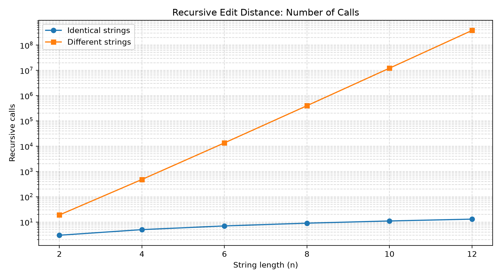
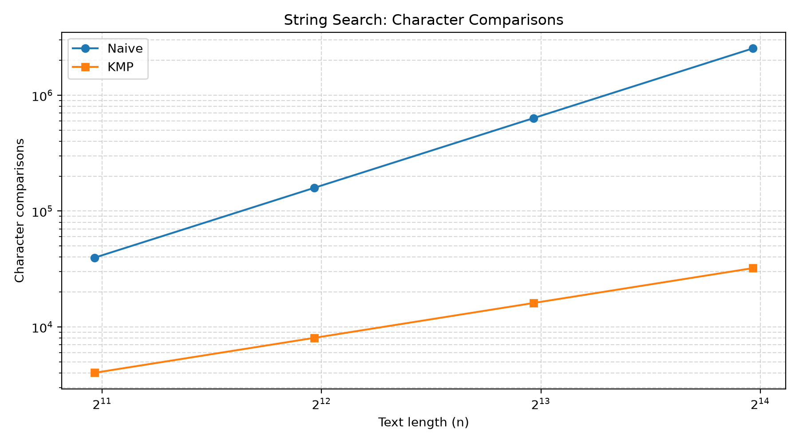
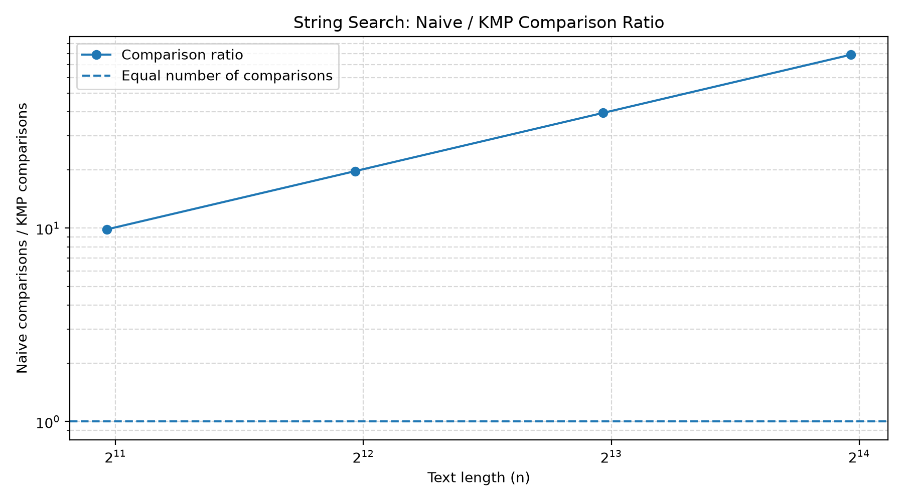
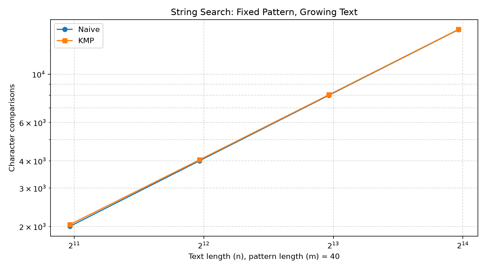
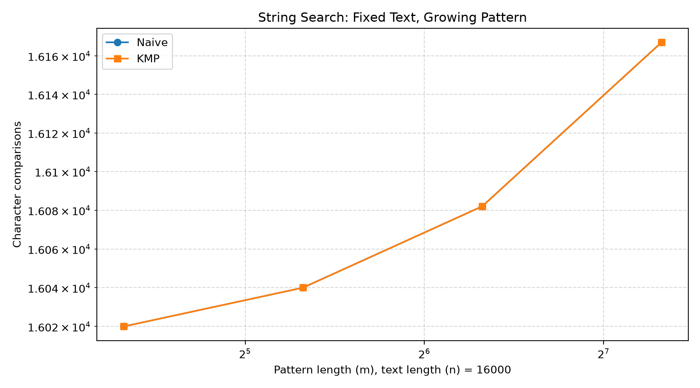

# DAA Assignment 4
# Dynamic Programming and String Algorithms

## 1. Experiment Design Card

**Scenario:** City Search & Spell-Check.

**Goal:** Compare different Edit Distance and String Search implementations using execution time, operation counters, and auxiliary memory estimates.

### Experiment questions

1. How does the input affect the performance of recursive Edit Distance, and how does it compare with dynamic programming?
2. How do Naive String Search and KMP differ in the number of character comparisons for different text and pattern sizes?

### Algorithms

**Edit Distance:**
- Recursive — direct recursion without memoization.
- Table — bottom-up dynamic programming using a full table.
- TwoRows — dynamic programming using two rows.

**String Search:**
- Naive — checks possible pattern alignments one by one.
- KMP — uses the LPS array to avoid unnecessary comparisons.

### Input sizes

| Experiment | Sizes |
|---|---|
| Recursive Edit Distance | 2, 4, 6, 8, 10, 12 |
| Table and TwoRows | 100, 200, 400, 800 |
| String Search text | 2,000, 4,000, 8,000, 16,000 |
| String Search pattern | 20, 40, 80, 160 |

The largest input is at least four times larger than the smallest input in each main experiment series.

### Input types

**Edit Distance:**
- Identical strings.
- Different strings.
- Random strings.

**String Search:**
- Best case.
- Worst case.
- Random input.
- Fixed pattern with growing text.
- Fixed text with growing pattern.
- Overlapping matches.

A fixed random seed (`42`) is used to make generated inputs reproducible.

### Metrics

- Median execution time in milliseconds, calculated from five runs.
- Recursive calls.
- Dynamic programming cells.
- Character comparisons.
- Maximum recursion depth.
- Estimated auxiliary storage cells.
- Text comparisons and LPS preprocessing comparisons.
- Number of matches returned.

The `char_comparisons` metric for KMP includes both text-search comparisons and LPS preprocessing comparisons.

### Predictions

- Recursive Edit Distance will grow very quickly on different strings because it has no memoization.
- Table and TwoRows will have \(O(nm)\) time complexity.
- TwoRows will use significantly less auxiliary memory than Table.
- KMP will perform fewer comparisons than Naive on difficult search inputs.
- Naive may remain competitive on simple inputs because it has less preprocessing overhead.

### Plots

Eight plots are generated:
1. Edit Distance execution time.
2. Edit Distance auxiliary storage.
3. Recursive Edit Distance execution time.
4. Recursive calls.
5. String Search character comparisons.
6. Naive/KMP comparison ratio.
7. Fixed pattern with growing text.
8. Fixed text with growing pattern.

---

## 2. Experimental Results

The benchmark produced 420 CSV rows, representing 84 unique experiment configurations with five runs per configuration.

### 2.1 Edit Distance

The Table and TwoRows implementations both perform \(O(nm)\) dynamic programming work.

At input size \(n=800\), both algorithms processed 640,000 DP cells. However, their auxiliary storage differed significantly:

| Algorithm | Auxiliary storage cells |
|---|---:|
| Table | 641,601 |
| TwoRows | 1,602 |

TwoRows used approximately 400 times fewer auxiliary storage cells at this input size.

The execution-time measurements did not show that TwoRows is always faster. At \(n=800\) with different strings, Table took 7.3128 ms, while TwoRows took 5.6571 ms. However, timing results can vary because of JVM and system activity.

**Plot takeaway:** TwoRows provides a substantial memory advantage while preserving the same DP time complexity. Its execution-time advantage is not guaranteed for every input size.

### 2.2 Recursive Edit Distance

The recursive implementation behaved very differently for identical and different strings.

For identical strings, the implementation finished quickly because matching characters allowed it to follow a much shorter recursive path.

For different strings, the number of recursive calls increased rapidly:

| Input size | Recursive calls | Median time |
|---:|---:|---:|
| 2 | 19 | 0.0096 ms |
| 4 | 481 | 0.0885 ms |
| 6 | 13,483 | 0.2988 ms |
| 8 | 398,593 | 2.9981 ms |
| 10 | 12,146,179 | 97.4191 ms |
| 12 | 377,393,953 | 2019.7967 ms |

The benchmark used a 2,000 ms stopping threshold. At \(n=12\), the median execution time exceeded this threshold, so the experiment stopped.

The largest tested input was therefore 12. The stopping condition was execution time, not a stack overflow or incorrect result.

**Plot takeaway:** Direct recursion becomes impractical quickly on different strings because the number of recursive calls grows exponentially.

### 2.3 Naive vs KMP String Search

The most significant difference appeared in the worst-case experiment.

| Text size | Naive comparisons | KMP comparisons | Naive/KMP ratio |
|---:|---:|---:|---:|
| 2,000 | 39,620 | 4,018 | 9.86 |
| 4,000 | 158,440 | 8,038 | 19.71 |
| 8,000 | 633,680 | 16,078 | 39.41 |
| 16,000 | 2,534,560 | 32,158 | 78.82 |

At \(n=16,000\), Naive performed 2,534,560 comparisons, while KMP performed only 32,158.

The KMP total includes LPS preprocessing comparisons. Therefore, the comparison is not ignoring the preprocessing cost.

**Plot takeaway:** The comparison gap increases as the input grows, demonstrating the advantage of KMP on difficult search inputs.

### 2.4 Fixed Pattern and Fixed Text Experiments

Additional experiments varied one input dimension while keeping the other fixed.

With a fixed pattern length of 40 and a growing text, both algorithms found exactly one match at every tested size.

The total character comparisons were:

| Text size | Naive | KMP |
|---:|---:|---:|
| 2,000 | 2,002 | 2,041 |
| 4,000 | 4,002 | 4,041 |
| 8,000 | 8,002 | 8,041 |
| 16,000 | 16,002 | 16,041 |

In this particular experiment, Naive performed slightly fewer total comparisons because KMP also had to build its LPS array.

With a fixed text length of 16,000 and a growing pattern, both algorithms found two matches for all tested pattern sizes. Their total character comparison counts were equal in the recorded experiments.

**Plot takeaway:** These experiments show that input structure and preprocessing overhead matter; KMP does not necessarily win every small or favorable case.

### 2.5 Overlapping Matches

The overlapping-match experiment used a text consisting of repeated `A` characters and a pattern of 40 `A` characters.

Both algorithms returned the expected number of matches:

| Text size | Expected matches | Naive | KMP |
|---:|---:|---:|---:|
| 2,000 | 1,961 | 1,961 | 1,961 |
| 4,000 | 3,961 | 3,961 | 3,961 |
| 8,000 | 7,961 | 7,961 | 7,961 |
| 16,000 | 15,961 | 15,961 | 15,961 |

This confirms that both implementations correctly support overlapping matches.

---

## 3. Prediction vs Result

| Prediction | Experimental result |
|---|---|
| Recursive implementation will grow very quickly on different strings. | Confirmed: it reached 377 million recursive calls at n=12. |
| Table and TwoRows will have the same DP time complexity. | Confirmed: both processed 640,000 DP cells at n=800. |
| TwoRows will use less memory. | Confirmed: 1,602 cells compared with 641,601 for Table at n=800. |
| KMP will perform fewer comparisons on difficult inputs. | Confirmed: about 78.82 times fewer comparisons at n=16,000. |
| Naive may be competitive on simple inputs. | Confirmed in the fixed-pattern experiment, where Naive performed slightly fewer comparisons. |

Overall, the predictions were mostly confirmed. The experiments also demonstrated that input structure and preprocessing costs affect practical performance.

---

## 4. Required Questions

### 1. Which input makes string search slowest, and why?

The worst-case input was the most difficult for Naive String Search. At text length 16,000 and pattern length 160, it performed 2,534,560 character comparisons.

This happens because many alignments share long matching prefixes before a mismatch occurs. Naive repeats much of this work at the next alignment.

KMP avoids many repeated comparisons by using its LPS array.

### 2. What is the maximum n handled by recursive Edit Distance, and what stopped it?

The largest tested input was \(n=12\).

At this size, the algorithm made 377,393,953 recursive calls and had a median execution time of 2019.7967 ms. The benchmark stopped because its median time exceeded the configured 2,000 ms threshold.

### 3. What is gained and lost with TwoRows compared with the full table?

TwoRows reduces auxiliary storage from \(O(nm)\) to \(O(m)\), while retaining \(O(nm)\) time complexity.

The main advantage is lower memory usage. The limitation is that the two-row implementation does not preserve the complete DP table, so it cannot directly reconstruct the full edit sequence from all intermediate states.

### 4. Which search algorithm would you choose for a city search platform?

I would choose KMP for the main city search implementation.

City names and street names can be searched repeatedly in large datasets. KMP avoids unnecessary repeated comparisons and provides linear search complexity after preprocessing.

Naive can still be useful for small inputs or simple cases because it is easier to implement and has no LPS preprocessing overhead.

### 5. Why is execution time not the only evidence?

Execution time depends on several external factors, including JVM warm-up, garbage collection, CPU activity, and other running processes.

For this reason, the project also measures operation counts, recursive calls, DP cells, and estimated auxiliary storage. These counters provide a more direct way to understand algorithmic behavior and compare implementations.

---

## 5. Conclusion

The experiments demonstrated the practical differences between recursive and dynamic programming approaches to Edit Distance, as well as between Naive and KMP String Search.

The recursive Edit Distance implementation became impractical quickly on different strings. TwoRows significantly reduced auxiliary memory compared with the full DP table. KMP demonstrated a strong advantage over Naive in the worst-case search experiments, although preprocessing overhead made Naive competitive in some simpler cases.

The results support choosing algorithms based on both theoretical complexity and actual input characteristics.

**Note:** `memory_cells` represents an algorithmic estimate of auxiliary storage cells, not a direct measurement of JVM heap usage in bytes.